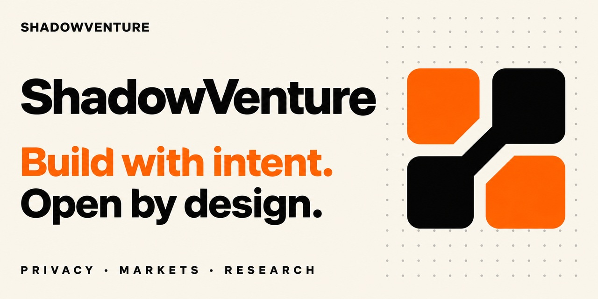
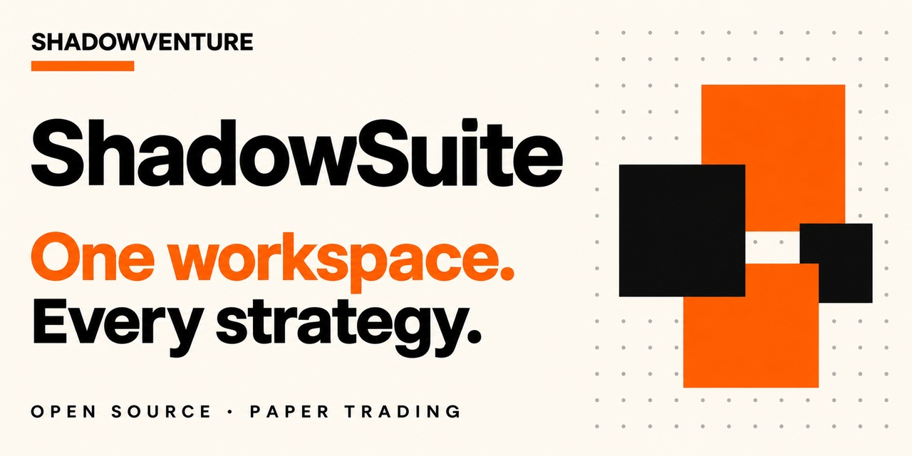
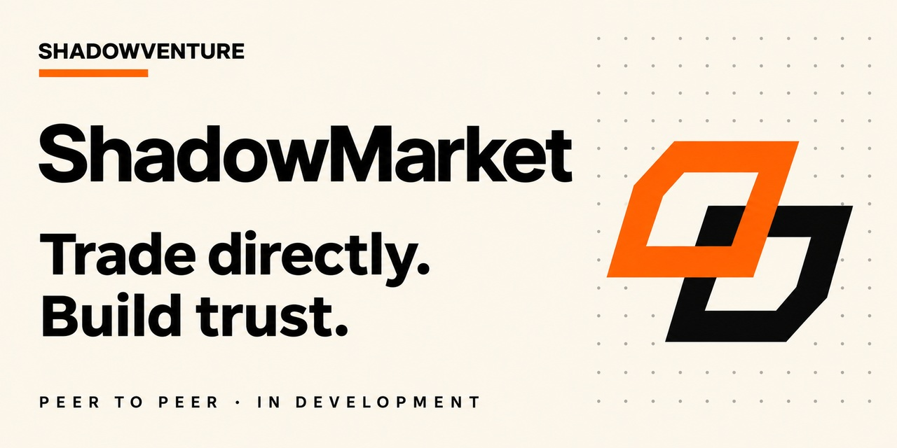
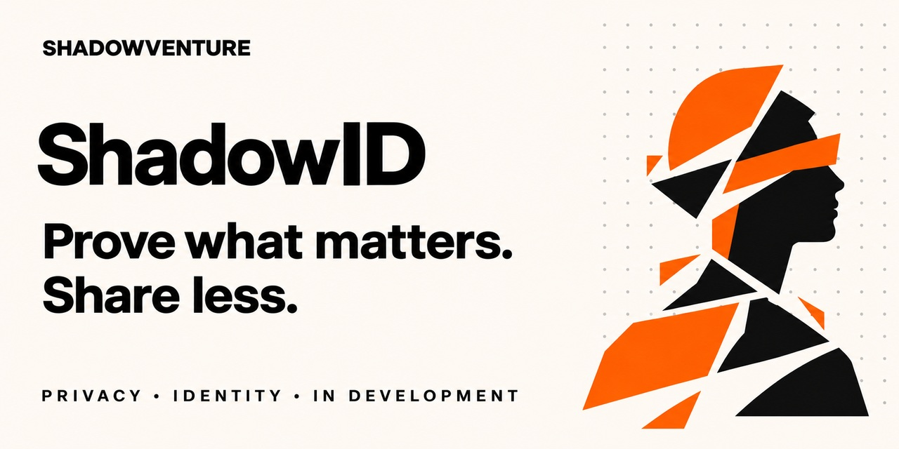
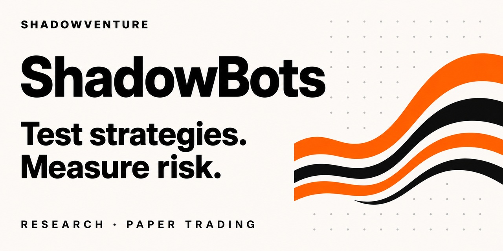

# ShadowVenture

**Independent technology projects. Shared principles.**

We are building tools around privacy, peer-to-peer commerce and transparent trading research.
Our projects share a focus on user control, explicit assumptions and reviewable engineering.

[Explore ShadowSuite](https://github.com/ShadowVenture/ShadowSuite) · [Help build ShadowMarket](https://github.com/ShadowVenture/ShadowMarket) · [Meet the founder](https://mrkbchmnn.com)

## Four projects. One direction.

<table>
<tr>
<td width="50%"></td>
<td width="50%"></td>
</tr>
<tr>
<td width="50%"></td>
<td width="50%"></td>
</tr>
</table>

| Project | Purpose | Current stage |
|---|---|---|
| **[ShadowSuite](https://github.com/ShadowVenture/ShadowSuite)** | A modular platform for your own bot plugins, central risk checks and a paper ledger | Public pre-alpha; paper trading only |
| **[ShadowMarket](https://github.com/ShadowVenture/ShadowMarket)** | A crypto-only peer-to-peer marketplace concept for direct trade | Public planning repository; no transactions or marketplace app yet |
| **ShadowID** | ShadowIdentity: privacy-preserving verification and user-controlled disclosure | Private landing-page repository; protocol and mobile apps planned |
| **ShadowBots** | Strategy research and simulation for the Shadow bot family | Private research; no live trading enabled |

Public access and readiness differ by project. A design goal is not an implemented feature or a security audit.

## Start building with us

**Try something:** clone [ShadowSuite](https://github.com/ShadowVenture/ShadowSuite) and follow its offline demo.

**Make a first contribution:** choose a [good first issue](https://github.com/ShadowVenture/ShadowSuite/issues?q=is%3Aissue%20is%3Aopen%20label%3A%22good%20first%20issue%22),
or help define [ShadowMarket's architecture](https://github.com/ShadowVenture/ShadowMarket/blob/main/ROADMAP.md).

**Share a reproducible problem:** open an issue in the relevant public repository.
For private project enquiries, contact [Mrk Bchmnn](mailto:mrk@mrkbchmnn.com).

## How we work

- Clear boundaries between plans, prototypes and verified behaviour.
- Small changes with evidence and documented limitations.
- Privacy and security considered from the design stage.
- English-first documentation for an international community.
- Respectful collaboration, useful feedback and visible credit for contributors.

**Founded by [Mrk Bchmnn](https://mrkbchmnn.com).**
